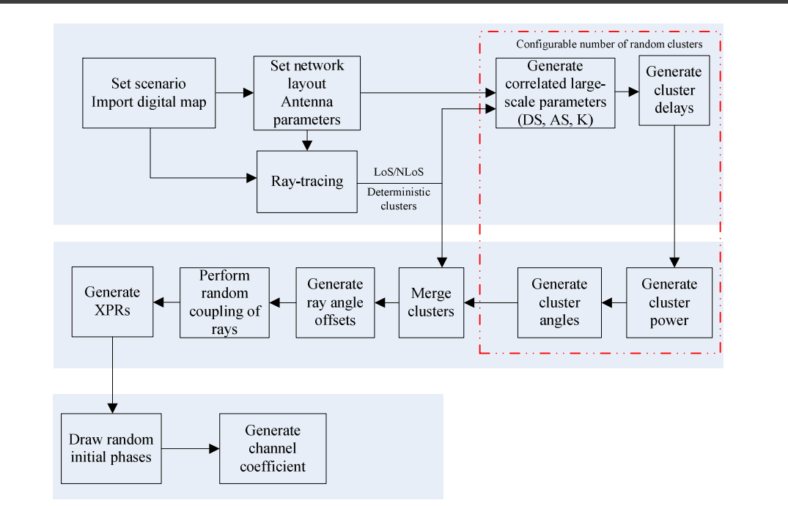

# HybridChannel

Hybrid RT–RC satellite channel simulator based on the map-based hybrid model in **3GPP TR 38.901 (v19), Clause 8**.

Sionna RT computes propagation paths in a 3D scene. Statistical random clusters supplement those paths through delay generation, duplicate-cluster removal, and power anchoring. The simulator produces complex MIMO channel impulse responses for configured satellite and user-terminal positions.

[Quick start](#quick-start) · [Experiments](#experiments) · [Outputs](#outputs) · [Model details](docs/model.md)

## Channel Generation



Source: **3GPP TR 38.901 V19.1.0, Clause 8.4, Figure 8.4-1**, “Channel coefficient generation procedure.” [ETSI PDF](https://www.etsi.org/deliver/etsi_TR/138900_138999/138901/19.01.00_60/tr_138901v190100p.pdf#page=151).

The figure describes the reference channel-generation procedure. See [model details](docs/model.md) for equations and assumptions.

## Quick Start

Open [hybrid_simulator.ipynb](hybrid_simulator.ipynb) to configure and run the simulator. The commands below target Linux/Ubuntu with Python 3.12 and a working NVIDIA driver.

```bash
# While this update is in PR #2, select its branch.
git clone --branch codex/notebook-simulator-integration https://github.com/Ollie-92/HybridChannel.git
cd HybridChannel
python3.12 -m venv .venv-notebook
source .venv-notebook/bin/activate
python -m pip install -r requirements-notebook.txt
python -m jupyterlab hybrid_simulator.ipynb
```

The dependency file specifies the package versions. Fresh-machine installation has not yet been verified.

Run the notebook in this order:

1. **Environment**: import the packages and initialize the runtime.
2. **Configuration**: set the mode, direction, frequency and endpoint antennas.
3. Choose **A: fixed positions** or **B: orbit**. Execute only the selected geometry section.
4. Create the channels and run the snapshot loop.
5. Inspect the output tables and plot the selected port pair's per-ray power.

The default is one satellite/UE pair, fixed positions, Hybrid downlink, 2 GHz and the included NYC scene. It uses 10 million RT samples per source, so it is not a lightweight installation test. Restart the kernel after updating Python modules.

## Experiments

Configure experiments directly in `hybrid_simulator.ipynb`:

| Setting | Options |
|---|---|
| `mode` | `rt`, `hybrid`, or `3gpp` (OpenNTN) |
| `directions` | `downlink`, `uplink`, or both |
| `topology` | Fixed positions or orbit; OpenNTN currently supports fixed topology |
| Endpoint antenna | Rows, columns, spacing, polarization and orientation |
| Scene | Existing `Scene/NYC_scene/NYC_sionna.xml`, or a configured scene XML |

A VH element contributes two ports. Fixed-position links are generated from enabled satellite/UE combinations; the notebook orbit example uses one satellite/UE pair. Spacing is in wavelengths, positions in meters and orientations in degrees. Optional ionosphere effects default to off and may require external model inputs.

<details>
<summary>Original CLI instructions (retained for existing users)</summary>


The recorded research environment uses **Ubuntu 24.04, Python 3.12, Sionna RT 1.2.1, and an NVIDIA RTX 5080**. Install Git, Python with `venv` support, and a working NVIDIA driver first. The original CLI instructions below remain available alongside the notebook entry point.

```bash
git clone https://github.com/Ollie-92/HybridChannel.git
cd HybridChannel
bash tools/install.sh
source .venv/bin/activate
python tools/check_installation.py --run-example
```

`tools/install.sh` creates `.venv` and installs the pinned dependencies. The check runs a three-position ground-plane example and generates channel data, plots, and CSV metrics. On success it prints `Example check passed:` followed by the output directory. Fresh-environment RT execution and numerical reproduction have not yet been validated.

If installation fails, check that Python 3.12 is available. For GPU/backend errors, check `nvidia-smi` and the [Sionna RT prerequisites](https://nvlabs.github.io/sionna/rt/installation.html). For simulation errors, read `run.log` in the printed `RUN_DIR`.

## Experiments


The following original CLI experiments remain available. Run commands from the repository root. Each JSON file contains the scene path and simulation parameters.

| Configuration | Scene | Channel | Positions |
|---|---|---|---|
| [example.json](Config/example.json) | Generated ground plane | Hybrid RT–RC | 3 |
| [nyc_hybrid.json](Config/nyc_hybrid.json) | NYC | Hybrid RT–RC | 5 |
| [nyc_consistent_rc.json](Config/nyc_consistent_rc.json) | NYC | Fixed-scatterer RC-only, with RT power anchoring | 5 |

```bash
python run_simulation.py --config Config/nyc_hybrid.json

# Fixed-scatterer RC-only
python run_simulation.py --config Config/nyc_consistent_rc.json

# Plot one completed run
python tools/plot_results.py Result/<run-directory> --trusted-local-output
```

Replace `<run-directory>` with the directory printed by the simulation. The NYC settings use 28 GHz and a 600 km scene altitude. The scene XML and referenced meshes are included in [Scene/NYC_scene](Scene/NYC_scene).

Edit the `cli` fields in a configuration to change frequency, antennas, receiver coordinates, trajectory, seed, or RT settings. For another scene, add `--scene /absolute/path/to/scene.xml` to the simulation command and adjust its geometry settings.

Each run saves CIR coefficients, delays, geometry, configuration, package versions, and logs under `Result/`. Analysis adds PDP/CFR plots and CSV metrics in `analysis/`. Only analyze trusted files: the saved channel uses NumPy object arrays.

</details>

## Outputs

Results are written to `hybrid_simulator/results/runs/<run>/<link>/<direction>/fixed` or `orbit_XXXX`. The notebook prints the exact location. Reusing a directory overwrites matching output files.

| Output | Contents |
|---|---|
| `channel_paths.csv` | Complex coefficients and delays for every port pair, ray/tap and time sample |
| `channel_matrix.csv` | Coherent channel matrix at the carrier |
| `cfr.csv` | Complex frequency response |
| `pdp.csv` | Unnormalized, incoherent path-power sums across all ports at equal delays |
| `inspection_summary.csv`, `port_metrics.csv`, `source_summary.csv` | Summary, per-port metrics and source composition, generated by Inspect outputs |
| `channel.npz`, `summary.json`, `CSV_README.txt` | Full arrays, metadata and field definitions |

For the per-ray plot, select `RX_PORT`, `TX_PORT`, `SNAPSHOT_INDEX` and `TIME_SAMPLE`. Each panel is normalized to its strongest ray (0 dB), and equal-delay rays overlap. The matching `ray_pdp_*.png` and `.csv` are stored in the link directory. This plot differs from the all-port `pdp.csv`; it does not show absolute gain differences between port pairs. OpenNTN paths are aggregated native taps. Channel gains are in dB, not received power in dBm.

## Repository Structure

The notebook and its modules are organized as follows:

```text
HybridChannel/
├── README.md
├── hybrid_simulator.ipynb
├── requirements-notebook.txt
├── hybrid_simulator/
│   ├── rt.py
│   ├── openntn.py
│   ├── hybrid_model.py
│   ├── channel_generator.py
│   ├── config.py
│   ├── csv_export.py
│   ├── ...
│   └── third_party/openntn/
└── Scene/NYC_scene/
```

`rt.py` and `openntn.py` are alongside the other modules; there is no `backends/` directory.

The original `Hybrid_channel/`, `Config/`, `tools/`, `run_simulation.py`, `requirements.txt` and existing `docs/` contents remain in the repository. The notebook package is not yet established as numerically equivalent to every original CLI mode. Twelve OpenNTN adapter comparisons passed against the pinned upstream; complete paper reproduction remains unverified.

## References

- 3GPP TR 38.901 V19.1.0, *Study on channel model for frequencies from 0.5 to 100 GHz*, Release 19, October 2025. [ETSI PDF](https://www.etsi.org/deliver/etsi_TR/138900_138999/138901/19.01.00_60/tr_138901v190100p.pdf).
- [Sionna RT](https://github.com/NVlabs/sionna-rt), ray-tracing library.

### OpenNTN

T. Düe, M. Vakilifard, C. Bockelmann, D. Wübben, and A. Dekorsy, “OpenNTN: An Open-Source Framework for Non-Terrestrial Network Channel Simulations,” *International Workshop on Smart Antennas (WSA)*, Erlangen, Germany, September 16–18, 2025. [Paper](https://www.ant.uni-bremen.de/sixcms/media.php/102/15183/OpenNTN_An_OpenSource_Framework_For_NTN_Simulations.pdf) · [Code](https://github.com/ant-uni-bremen/OpenNTN).

<details>
<summary>BibTeX</summary>

```bibtex
@inproceedings{OpenNTNPaper,
  author    = {T. D{\"u}e and M. Vakilifard and C. Bockelmann and D. W{\"u}bben and A. Dekorsy},
  title     = {{OpenNTN}: An Open-Source Framework for Non-Terrestrial Network Channel Simulations},
  booktitle = {International Workshop on Smart Antennas (WSA)},
  address   = {Erlangen, Germany},
  year      = {2025},
  month     = sep,
  url       = {https://www.ant.uni-bremen.de/sixcms/media.php/102/15183/OpenNTN_An_OpenSource_Framework_For_NTN_Simulations.pdf}
}
```

</details>

## Publication

**An Open-Source Hybrid Ray-Tracing and 3GPP Channel Simulator for Non-Terrestrial Network**

[arXiv:2610.37536](https://arxiv.org/abs/2610.37536)

If you use HybridChannel, its simulation results, or its implementation methods in academic work, you must cite this paper.

## Usage Notice

The authors permit academic research use of the original HybridChannel code provided that the associated paper above is correctly cited. All other rights are reserved. Redistribution, modification, or commercial use requires prior written permission from the authors, unless separately authorized.

Academic work using this implementation must cite *An Open-Source Hybrid Ray-Tracing and 3GPP Channel Simulator for Non-Terrestrial Network* ([arXiv:2610.37536](https://arxiv.org/abs/2610.37536)). Please also include the repository URL, https://github.com/Ollie-92/HybridChannel, and identify the commit used for reproducibility.

This notice applies only to original project material. Third-party software, scene assets, and reproduced figures remain subject to their respective rights and licenses.
